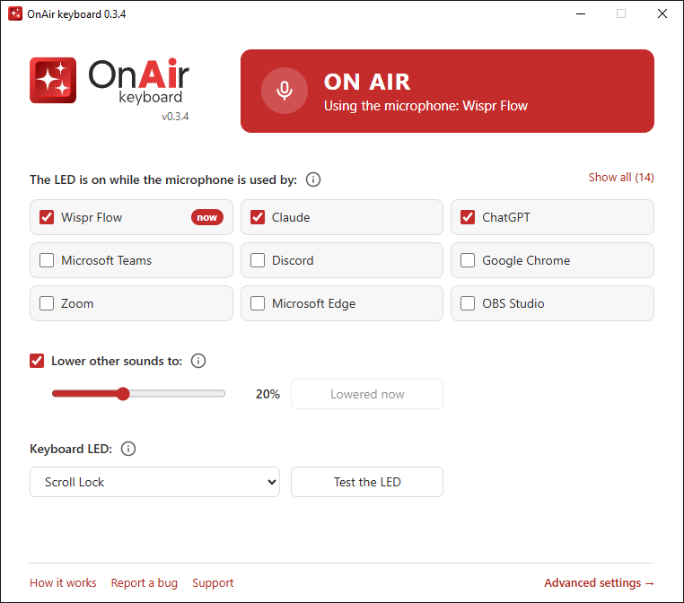
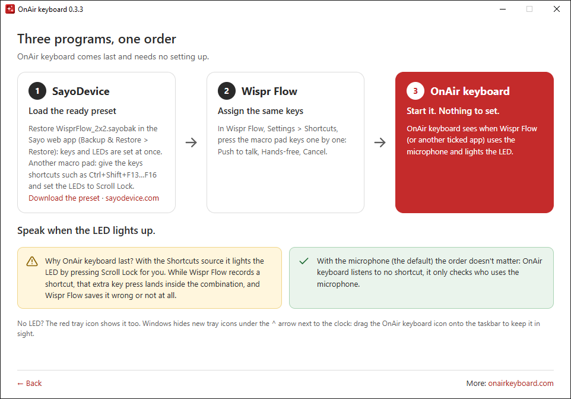
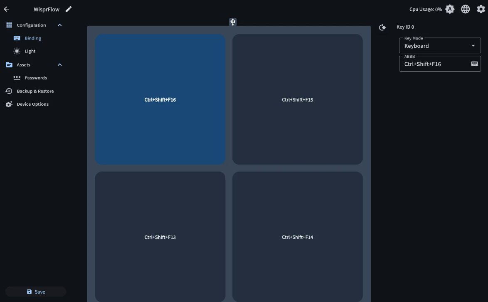
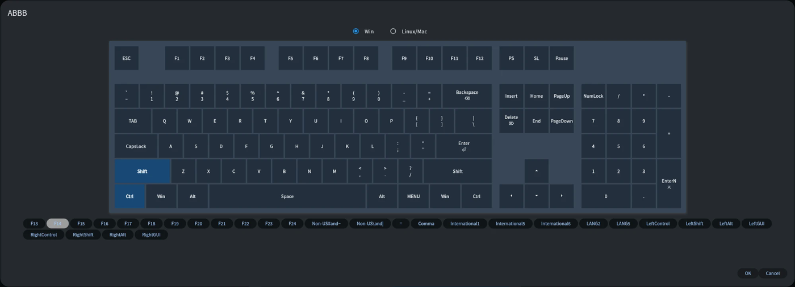

<p align="center">
  <picture>
    <source media="(prefers-color-scheme: dark)" srcset="assets/src/logo-dark.svg">
    <source media="(prefers-color-scheme: light)" srcset="assets/src/logo-bright.svg">
    
  </picture>
</p>

<h3 align="center">One key. No guessing.</h3>

<p align="center">
  Your keyboard LED lights up red while you dictate.
</p>

<p align="center">
  <a href="https://github.com/onairkeyboard/onairkeyboard/releases/latest"></a>
  <a href="https://onairkeyboard.com"></a>
  <a href="https://github.com/sponsors/onairkeyboard"></a>
  <a href="https://buycoffee.to/onairkeyboard"></a>
  
</p>

<p align="center"><a href="README.pl.md">Polski</a> · English</p>

---

## Why

Dictating with [Wispr Flow](https://wisprflow.ai) and similar apps can make you several times faster.
But with no clear sign that recording is on, the classics happen: minutes of talking that were
never captured, or a conversation that keeps getting transcribed.

OnAir keyboard turns on an "on air" light: your keyboard LED (a small macro pad, for example) and a
red tray icon. It glows exactly while a chosen app uses the microphone. Install it and it works,
no shortcuts to set up.

<p align="center"><picture><source media="(prefers-color-scheme: dark)" srcset="docs/img/window-main-en-dark.png"><source media="(prefers-color-scheme: light)" srcset="docs/img/window-main-en-light.png"></picture></p>

## Features

- **The LED is on while an app uses the microphone:** Wispr Flow, Claude, ChatGPT, Aqua Voice and
  any other you tick. The list comes from the microphone history in Windows: nothing to type in.
- **Your keyboard LED as an "on air" light.** Works with any keyboard whose LEDs can show a Lock
  state (SayoDevice, for example): Scroll Lock by default, Num Lock or Caps Lock to choose.
- **A red tray icon**, so OnAir keyboard helps even without an LED.
- **For the advanced: Wispr Flow shortcuts** (the LED turns on as you release the key) or a
  hybrid: a shortcut turns it on, the microphone corrects it.
- **Light and dark theme** following Windows, Polish and English, one small EXE that installs itself
  on request (no administrator rights).

## Requirements

- Windows 10 or 11 (the window uses Microsoft Edge WebView2, which Windows 11 always has and
  Windows 10 almost always; without it OnAir keyboard keeps working from the tray and tells you
  where to get it)
- A dictation app, such as [Wispr Flow](https://wisprflow.ai)
- Optional: a keyboard whose LEDs can show a Lock state (without one, the tray icon does the job)

## Getting started

Three programs, one order: **SayoDevice → Wispr Flow → OnAir keyboard**. OnAir keyboard comes last
and needs no setting up.

<p align="center"><picture><source media="(prefers-color-scheme: dark)" srcset="docs/img/window-howto-en-dark.png"><source media="(prefers-color-scheme: light)" srcset="docs/img/window-howto-en-light.png"></picture></p>

**1. Macro pad.** Have a SayoDevice 2x2? Download
[WisprFlow_2x2.sayobak](presets/WisprFlow_2x2.sayobak), open [sayodevice.com](https://sayodevice.com)
in Chrome or Edge, connect the pad and choose **Backup & Restore → Restore**, then **Save**. Keys and
LEDs are set at once:

| Key (SayoDevice ID) | Shortcut | Wispr Flow action |
|---|---|---|
| Top left (ID 0) | `Ctrl+Shift+F16` | Cancel |
| Top right (ID 1) | `Ctrl+Shift+F15` | Paste last transcript |
| Bottom left (ID 2) | `Ctrl+Shift+F13` | Push to talk |
| Bottom right (ID 3) | `Ctrl+Shift+F14` | Hands-free |

Another macro pad: give its keys such shortcuts in its software and set the LEDs to the Scroll Lock
indicator.

<details>
<summary><b>Setting the keys by hand in SayoDevice</b></summary>

1. Open [sayodevice.com](https://sayodevice.com) in Chrome or Edge, connect the macro pad and go to
   **Configuration → Binding**.
2. Click a key, set **Key Mode** to **Keyboard** and click the keyboard icon in the shortcut field.

   

3. Select **Ctrl** and **Shift** on the on-screen keyboard, pick the F key from the bar below it
   (F13–F24 are there), then click **OK**.

   

4. Repeat for the other keys. In **Configuration → Light**, set the LEDs to Indicator → Scroll Lock
   and pick a colour (red suits "on air").
5. Click **Save** to store the settings on the pad.

If restoring the backup warns that it doesn't match the device, you have another model: cancel and
set the keys by hand. **Why F13 and up?** Ordinary keyboards stop at F12, so no program uses them,
and `Ctrl+Shift` is a second safety catch.

</details>

**2. Wispr Flow.** In *Settings → Shortcuts*, press the macro pad keys one by one for Push to talk,
Hands-free and Cancel.

**3. OnAir keyboard.** Download `OnAirKeyboard-<version>.exe` from
[Releases](https://github.com/onairkeyboard/onairkeyboard/releases/latest) and run it. On the first
start it asks whether to install itself: **Yes** copies it to `%LOCALAPPDATA%\Programs\OnAirKeyboard`
and adds a Start menu shortcut (you can delete the downloaded file); **No** runs it from where it
is. Nothing else to set.

Done: **speak when the LED lights up.**

> Windows may show "Windows protected your PC", because the file isn't digitally signed yet. Click
> **More info → Run anyway**. See [SmartScreen and antivirus](#smartscreen-and-antivirus).

Updating: download the new version and run it; OnAir keyboard offers to replace the installed copy.
Your settings stay; after updating from 0.1 the signal source is the microphone, and your
shortcuts wait in the advanced settings.

## Advanced settings

Double-click the tray icon to open the window; **Advanced settings →** in its footer leads to the
rest:

- **Signal source:** *Microphone* (recommended), *Keyboard shortcuts* (the LED turns on as you
  release a Wispr Flow shortcut, Wispr Flow only) or *Both* (a shortcut turns it on; when
  Wispr Flow's microphone doesn't open within a few seconds, the LED goes off).
- **Wispr Flow shortcuts:** for the shortcut sources, click **Assign** and press the same key you
  use in Wispr Flow. Set the shortcuts in Wispr Flow first: OnAir keyboard lights the LED by
  pressing Scroll Lock for you, and that extra key press would spoil a combination being recorded
  in Wispr Flow. That's why OnAir keyboard pauses itself while a Wispr Flow window is active.
- **Indicator, General, Diagnostics, About.**

## Good to know

- **A browser is one app.** Windows doesn't say which tab uses the microphone, so a ticked Chrome
  also lights the LED during a Meet call.
- **The LED turns on about half a second after recording starts**, which is when the app really
  listens. **With Push to talk the LED stays off** while you hold the key: a Lock press in the
  middle of a Wispr Flow shortcut would delay or end the recording. The red tray icon shows it.
- **Keep the tray icon in sight.** Windows hides new tray icons under the **^** arrow next to the
  clock. Drag the OnAir keyboard icon from there onto the taskbar.
- **The Lock really toggles.** With Scroll Lock as the indicator, the arrow keys scroll the sheet in
  Excel while you dictate. With Caps Lock, letters come out in capitals.
- If a "Scroll Lock on" notification pops up, it comes from your mouse or keyboard software (such
  as Logitech SetPoint), not from Windows. Turn it off there.

<details>
<summary><b>Why Wispr Flow? Why four keys? Why not Escape?</b></summary>

**Why Wispr Flow?** I've tried several alternatives, and Wispr Flow works best of them all. I use it
every day myself, and OnAir keyboard is built around exactly how I work with it. The microphone LED
works with any app, though.

**Why four keys?** Most people talk to their AI with the basics: **Push to talk, Hands-free and
Cancel**. The fourth key goes to **Paste last transcript**: when the cursor wasn't in a text field
and the text landed nowhere, click into the field, press the fourth key, and your last dictation
appears.

**Why not Escape?** Wispr Flow's default Cancel is `Escape`, but Escape also interrupts other
programs. If Claude Code or ChatGPT is working, one press cancels your dictation and stops the AI
too. Put Cancel on a dedicated key of your macro pad.

</details>

## Privacy

OnAir keyboard reads only the microphone usage timestamps and app names from the Windows registry
(the same entry Windows draws its microphone icon from). It never touches audio, reads no text,
collects no data and doesn't connect to the internet, except for opening links in your browser
when you click them. The window shows only files stored on your computer. With the Shortcuts
source, OnAir keyboard only listens to the Wispr Flow shortcuts and blocks nothing.

## SmartScreen and antivirus

OnAir keyboard is written in [AutoHotkey](https://www.autohotkey.com) and compiled to an EXE. Such
files aren't digitally signed yet, so Windows SmartScreen warns about them and some antivirus
programs flag them by mistake. The full source code is in this repository, and you can
[build the EXE yourself](#building-from-source).

## Settings and uninstalling

Settings live in `%APPDATA%\OnAirKeyboard\config.ini` (*About* shows the path), the window's files
in `%LOCALAPPDATA%\OnAirKeyboard`. To remove OnAir keyboard: untick *Start with Windows*, exit it from
the tray menu, then delete:

- the program folder `%LOCALAPPDATA%\Programs\OnAirKeyboard` (or just the downloaded EXE, if it
  wasn't installed),
- the *OnAir keyboard* Start menu shortcut (right-click → *Open file location*),
- the folders `%APPDATA%\OnAirKeyboard` and `%LOCALAPPDATA%\OnAirKeyboard`.

## Building from source

Requirements: [AutoHotkey v2.0](https://www.autohotkey.com) and Ahk2Exe 1.1.37 or newer (installed by
AutoHotkey Dash → Compile). The WebView2 library is in `lib/` (see [lib/README.md](lib/README.md)),
the window's page in `ui/`.

```powershell
powershell -ExecutionPolicy Bypass -File tests\run.ps1      # tests
powershell -ExecutionPolicy Bypass -File build.ps1          # dist\OnAirKeyboard-<version>.exe
powershell -ExecutionPolicy Bypass -File tests\run.ps1 -Exe # tests incl. the EXE
powershell -ExecutionPolicy Bypass -File tools\run-demo.ps1 # run from source
```

Icons are generated from `assets/src` with `python -I assets/build_icons.py` (needs Inkscape).

## Report a bug

Something doesn't work? Click **Report a bug** in the window's footer (or in the tray menu). The
window shows the address [hello@onairkeyboard.com](mailto:hello@onairkeyboard.com), a subject and a
ready e-mail text: three short questions plus the technical details OnAir keyboard fills in for you
(version, Windows, signal source, shortcuts; nothing personal). The **Copy** buttons put them on the
clipboard, so you can send the report from any mailbox. Attaching the diagnostic log helps a lot:
turn it on in *Advanced settings → Diagnostics*, make the problem happen again and attach
`onairkeyboard.log`.

## Support

Hi, I'm Patryk Szulczewski. I built OnAir keyboard to make my life simpler. If it made yours simpler too,
here's your chance to say thanks:

<a href="https://github.com/sponsors/onairkeyboard"></a>
<a href="https://buycoffee.to/onairkeyboard"></a>

More about OnAir keyboard: [onairkeyboard.com](https://onairkeyboard.com)

## License

[MIT](LICENSE) © 2026 Patryk Szulczewski. The window uses
[WebView2 for AutoHotkey](https://github.com/thqby/ahk2_lib) (thqby, MIT) and Microsoft's
WebView2Loader.dll.

OnAir keyboard is an independent project, not affiliated with Wispr AI (Wispr Flow) or SayoDevice.
