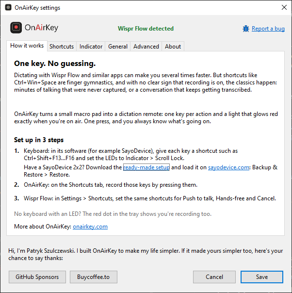
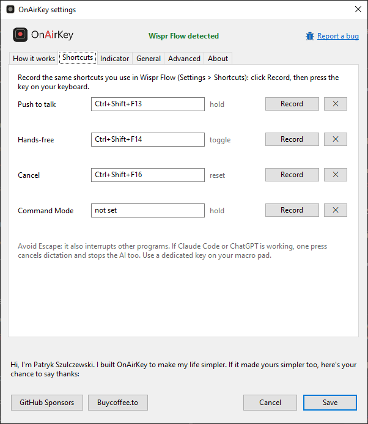

<p align="center">
  <picture>
    <source media="(prefers-color-scheme: dark)" srcset="assets/logo-dark.svg">
    
  </picture>
</p>

<h3 align="center">One key. No guessing.</h3>

<p align="center">
  Your keyboard LED lights up red while Wispr Flow is recording.
</p>

<p align="center">
  <a href="https://github.com/onairkey/onairkey/releases/latest"></a>
  <a href="https://onairkey.com"></a>
  <a href="https://github.com/sponsors/onairkey"></a>
  <a href="https://buycoffee.to/onairkey"></a>
  
</p>

<p align="center"><a href="README.pl.md">Polski</a> · English</p>

---

## Why

Dictating with [Wispr Flow](https://wisprflow.ai) and similar apps can make you several times faster.
But shortcuts like `Ctrl+Win+Space` are finger gymnastics, and with no clear sign that recording is
on, the classics happen: minutes of talking that were never captured, or a conversation that keeps
getting transcribed.

OnAirKey turns a small macro pad into a dictation remote: one key per action and a light that glows
red exactly when you're on air. One press, and you always know what's going on.

<p align="center"></p>

## Features

- **Keyboard LED as an "on air" light.** Works with any keyboard whose LEDs can show a Lock key
  state (for example SayoDevice macro pads): Scroll Lock by default, Num Lock or Caps Lock to choose.
- **Red tray icon while recording**, so OnAirKey helps even without a keyboard LED.
- **All Wispr Flow recording actions:** Push to talk, Hands-free, Cancel and Command Mode.
- **Record shortcuts by pressing them**, including F13–F24 and Wispr's default shortcuts such as
  `Ctrl+Win`.
- **Polish and English**, starts with Windows, a single small EXE that installs itself on request
  (no administrator rights, no separate installer).
- **Private by design:** OnAirKey only listens for your shortcuts. It never blocks keys, reads no
  text, collects no data and makes no internet connections.

## Requirements

- Windows 10 or 11
- [Wispr Flow](https://wisprflow.ai) for desktop
- Optional: a keyboard whose LEDs can follow a Lock key (otherwise use the tray icon)

## Get started

**0. Download** `OnAirKey.exe` from [Releases](https://github.com/onairkey/onairkey/releases/latest)
and run it. On the first start OnAirKey asks whether to install itself: **Yes** copies it to
`%LOCALAPPDATA%\Programs\OnAirKey` and adds a Start menu shortcut (no administrator rights needed),
so you can delete the downloaded file; **No** runs it from where it is and doesn't ask again.
Then the settings window opens on *How it works*. To update, download the new version and run it:
OnAirKey offers to replace the installed copy and keeps your settings.

> Windows may show "Windows protected your PC" because the EXE isn't code-signed yet. Click
> **More info → Run anyway**. See [SmartScreen and antivirus](#smartscreen-and-antivirus).

**1. Keyboard.** In your keyboard's software, give each key a shortcut and set the LEDs to the
Lock indicator. Example for a SayoDevice 2x2 macro pad (SayoDevice numbers the keys row by row):

| Key (SayoDevice ID) | Shortcut | Wispr Flow action | LED |
|---|---|---|---|
| Top left (ID 0) | `Ctrl+Shift+F16` | Cancel | Indicator → Scroll Lock |
| Top right (ID 1) | `Ctrl+Shift+F15` | Paste last transcript | Indicator → Scroll Lock |
| Bottom left (ID 2) | `Ctrl+Shift+F13` | Push to talk | Indicator → Scroll Lock |
| Bottom right (ID 3) | `Ctrl+Shift+F14` | Hands-free | Indicator → Scroll Lock |

**Why F13 and above?** A regular keyboard only has F1–F12, so no program has a reason to use
F13–F24. They still exist in the USB standard, and macro pads can send them. `Ctrl+Shift` adds a
second safety net: even if some program reacts to a plain F13, the combination stays free.

> **Have a SayoDevice 2x2?** Skip the manual setup: download
> [WisprFlow_2x2.sayobak](presets/WisprFlow_2x2.sayobak), a backup with exactly the keys and LEDs
> from the table above.
>
> 1. Open [sayodevice.com](https://sayodevice.com) in Chrome or Edge (other browsers can't talk to
>    the keyboard) and connect your macro pad.
> 2. Go to **Backup & Restore → Restore**, pick the downloaded file, select what to restore (keys
>    and lights) and confirm.
> 3. Click **Save** to store the settings on the keyboard.
>
> If the app warns that the backup doesn't match the device, you have a different model: cancel
> and set the keys by hand.

<details>
<summary><b>Setting the keys by hand in SayoDevice</b></summary>

1. Open [sayodevice.com](https://sayodevice.com) in Chrome or Edge, connect the macro pad and go
   to **Configuration → Binding**.
2. Click a key, set **Key Mode** to **Keyboard**, then click the keyboard icon in the shortcut
   field.

   

3. Select **Ctrl** and **Shift** on the keyboard and the F key in the bar below it (F13–F24 are
   there), then click **OK**.

   

4. Repeat for the other keys. In **Configuration → Light**, set the LEDs to Indicator → Scroll Lock
   and pick a colour (red fits "on air").
5. Click **Save** to store the settings on the keyboard.

</details>

**2. OnAirKey.** On the *Shortcuts* tab, click **Record** next to each action and press the key on
your macro pad. Paste last transcript doesn't need to be recorded: it doesn't change the recording
state.

<p align="center"></p>

**3. Wispr Flow.** In *Settings → General → Shortcuts*, set the same shortcuts for Push to talk,
Hands-free and Cancel.

Done: press Push to talk or Hands-free and the LED turns red.

## Why only four keys?

Let's be honest: Wispr Flow can do a lot more. But most people don't use the bells and whistles.
They talk to their AI with the basics: **Push to talk, Hands-free and Cancel**. Command Mode is there
too, and OnAirKey supports it, but it's used far less often. The fourth key on the pad goes to
**Paste last transcript** (see below).

OnAirKey is a specific solution to a specific problem for a specific group of users, not a
do-it-all multitool. A more universal version may come one day, but not now: that's not what
matters.

## Why Wispr Flow?

I've tried several alternatives, and Wispr Flow works best of them all. I use it every day myself,
and OnAirKey is built around exactly how I work with it.

## Why Paste last transcript on the fourth key?

It happens to everyone: you dictate, but the cursor wasn't in a text field (or the window lost
focus), and the text lands nowhere. Wispr Flow keeps it. Click into the field, press the fourth key,
and your last dictation appears. No retyping, no saying it all again, no shortcut to remember.

OnAirKey doesn't need this key recorded: pasting doesn't change the recording state.

## Why not Escape?

Wispr Flow's default Cancel is `Escape`, but Escape also interrupts other programs. If Claude Code
or ChatGPT is working, one press cancels your dictation and stops the AI too. Put Cancel on a
dedicated key of your macro pad. OnAirKey still supports Escape, but warns you about it.

## Good to know

- **Keep the tray icon in sight.** Windows hides new tray icons under the **^** arrow next to the
  clock. Drag the OnAirKey icon from there onto the taskbar, so the red icon is always visible.
  On Windows 11 you can also turn it on in *Settings → Personalization → Taskbar → Other system
  tray icons*.
- **OnAirKey follows your shortcuts, not Wispr itself.** If recording changes some other way
  (double-tapping Push to talk, stopping it with the mouse in the Flow Bar, the automatic stop
  after 20 minutes), the LED can stay on. Press Cancel and it's back in sync.
- **The Lock key really toggles.** With Scroll Lock as the indicator, arrow keys scroll the sheet in
  Excel while you dictate. With Caps Lock, letters come out in capitals.
- A shortcut can have one key besides Ctrl / Alt / Shift / Win (Wispr also allows two, such as
  `Ctrl+A+B`; OnAirKey doesn't yet).
- If a "Scroll Lock on" notification pops up, it comes from your mouse or keyboard software
  (for example Logitech SetPoint), not from Windows. You can turn it off there.

## SmartScreen and antivirus

OnAirKey is written in [AutoHotkey](https://www.autohotkey.com) and compiled into an EXE. Such files
aren't code-signed yet, so Windows SmartScreen warns about them and some antivirus programs flag
them by mistake, especially because the program listens to the keyboard. The full source code is in
this repository, and you can [build the EXE yourself](#build-from-source).

## Settings and uninstalling

Settings live in `%APPDATA%\OnAirKey\config.ini` (the path is shown on the *About* tab). To remove
OnAirKey: untick *Start with Windows*, exit from the tray menu, then delete:

- the program folder `%LOCALAPPDATA%\Programs\OnAirKey` (or `OnAirKey.exe` wherever you run it
  from, if you didn't install it),
- the *OnAirKey* shortcut in the Start menu (right-click → *Open file location*),
- the settings folder `%APPDATA%\OnAirKey`.

## Build from source

Requirements: [AutoHotkey v2.0](https://www.autohotkey.com) and Ahk2Exe 1.1.37 or newer
(AutoHotkey Dash → Compile installs it).

```powershell
powershell -ExecutionPolicy Bypass -File tests\run.ps1      # tests
powershell -ExecutionPolicy Bypass -File build.ps1          # dist\OnAirKey.exe
powershell -ExecutionPolicy Bypass -File tests\run.ps1 -Exe # tests incl. the EXE
powershell -ExecutionPolicy Bypass -File tools\run-demo.ps1 # try it from source
```

Icons are generated from `assets/src` with `python -I assets/build_icons.py` (needs Inkscape).

## Report a bug

Something doesn't work? Click **🐞 Report a bug** at the top of the settings window (or in the
tray menu). A window shows the address [bug@onairkey.com](mailto:bug@onairkey.com), a subject and
a ready e-mail text: three short questions plus the technical details OnAirKey fills in for you
(version, Windows, shortcuts; nothing personal). **Copy address** and **Copy text** put them on
the clipboard, so you can send the report from any mailbox, Gmail included. Attaching the
diagnostic log helps a lot: turn it on in *Settings → General*, make the problem happen again and
attach `onairkey.log`.

## Support

Hi, I'm Patryk Szulczewski. I built OnAirKey to make my life simpler. If it made yours simpler too,
here's your chance to say thanks:

<a href="https://github.com/sponsors/onairkey"></a>
<a href="https://buycoffee.to/onairkey"></a>

More about OnAirKey: [onairkey.com](https://onairkey.com)

## License

[MIT](LICENSE) © 2026 Patryk Szulczewski

The bug icon comes from [Ionicons](https://ionic.io/ionicons)
([MIT](assets/src/LICENSE-ionicons.txt), © Ionic).

OnAirKey is an independent project, not affiliated with Wispr AI (Wispr Flow) or SayoDevice.
