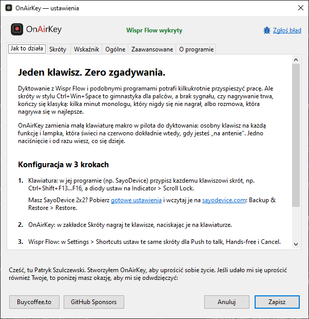
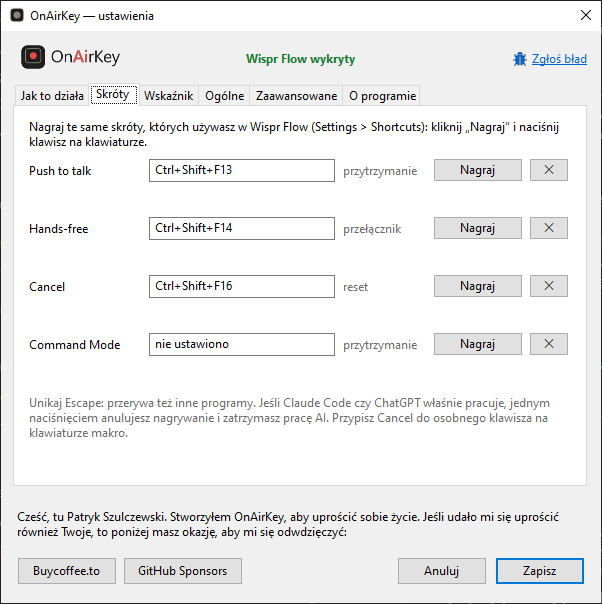

<p align="center">
  
</p>

<h3 align="center">Jeden klawisz. Zero zgadywania.</h3>

<p align="center">
  Dioda na klawiaturze świeci na czerwono, gdy Wispr Flow nagrywa.
</p>

<p align="center">
  <a href="https://github.com/onairkeyboard/onairkeyboard/releases/latest"></a>
  <a href="https://onairkeyboard.com"></a>
  <a href="https://buycoffee.to/onairkeyboard"></a>
  <a href="https://github.com/sponsors/onairkeyboard"></a>
  
</p>

<p align="center">Polski · <a href="README.md">English</a></p>

---

## Po co to

Dyktowanie z [Wispr Flow](https://wisprflow.ai) i podobnymi programami potrafi kilkukrotnie
przyspieszyć pracę. Ale skróty w stylu `Ctrl+Win+Space` to gimnastyka dla palców, a brak sygnału,
czy nagrywanie trwa, kończy się klasyką: kilka minut monologu, który nigdy się nie nagrał, albo
rozmowa, która nagrywa się w najlepsze.

OnAir keyboard zamienia małą klawiaturę makro w pilota do dyktowania: osobny klawisz na każdą funkcję
i lampka, która świeci na czerwono dokładnie wtedy, gdy jesteś „na antenie”. Jedno naciśnięcie
i od razu wiesz, co się dzieje.

<p align="center"></p>

## Co potrafi

- **Dioda klawiatury jako lampka „na antenie”.** Działa z każdą klawiaturą, której diody umieją
  pokazywać stan Locka (np. klawiatury makro SayoDevice): domyślnie Scroll Lock, do wyboru Num Lock
  albo Caps Lock.
- **Czerwona ikona w zasobniku podczas nagrywania**, więc OnAir keyboard pomaga także bez diody.
- **Wszystkie akcje nagrywania Wispr Flow:** Push to talk, Hands-free, Cancel i Command Mode.
- **Skróty nagrywasz, naciskając je**, także F13–F24 i domyślne skróty Wispr, np. `Ctrl+Win`.
- **Po polsku i po angielsku**, uruchamia się z Windows, jeden mały plik EXE, który na życzenie
  sam się instaluje (bez uprawnień administratora i osobnego instalatora).
- **Prywatny z założenia:** OnAir keyboard tylko nasłuchuje Twoich skrótów. Niczego nie blokuje, nie czyta
  tekstu, nie zbiera danych i nie łączy się z internetem.

## Wymagania

- Windows 10 lub 11
- [Wispr Flow](https://wisprflow.ai) na komputer
- Opcjonalnie: klawiatura, której diody mogą pokazywać stan Locka (bez niej działa ikona w zasobniku)

## Pierwsze kroki

**0. Pobierz** `OnAirKeyboard-<wersja>.exe` z [Releases](https://github.com/onairkeyboard/onairkeyboard/releases/latest)
i uruchom. Przy pierwszym starcie OnAir keyboard zapyta, czy się zainstalować: **Tak** kopiuje go do
`%LOCALAPPDATA%\Programs\OnAirKeyboard` i dodaje skrót w menu Start (bez uprawnień administratora),
więc pobrany plik możesz usunąć; **Nie** uruchamia go tam, gdzie leży, i więcej nie pyta. Potem
okno ustawień otworzy się na zakładce *Jak to działa*. Aktualizacja: pobierz nową wersję
i uruchom ją, a OnAir keyboard zaproponuje zastąpienie zainstalowanej kopii (ustawienia zostają).

> Windows może pokazać „System Windows ochronił ten komputer”, bo plik nie ma jeszcze podpisu
> cyfrowego. Kliknij **Więcej informacji → Uruchom mimo to**. Zobacz
> [SmartScreen i antywirusy](#smartscreen-i-antywirusy).

**1. Klawiatura makro.** W programie klawiatury przypisz każdemu klawiszowi skrót, a diody ustaw na
wskaźnik Locka. Przykład dla klawiatury SayoDevice 2x2 (SayoDevice numeruje klawisze wierszami):

| Klawisz (ID w SayoDevice) | Skrót | Akcja w Wispr Flow | Dioda |
|---|---|---|---|
| Lewy górny (ID 0) | `Ctrl+Shift+F16` | Cancel | Indicator → Scroll Lock |
| Prawy górny (ID 1) | `Ctrl+Shift+F15` | Paste last transcript | Indicator → Scroll Lock |
| Lewy dolny (ID 2) | `Ctrl+Shift+F13` | Push to talk | Indicator → Scroll Lock |
| Prawy dolny (ID 3) | `Ctrl+Shift+F14` | Hands-free | Indicator → Scroll Lock |

**Dlaczego F13 i wyżej?** Zwykła klawiatura ma tylko F1–F12, więc żaden program nie ma powodu
używać F13–F24. Te klawisze istnieją jednak w standardzie USB i klawiatury makro potrafią je
wysyłać. `Ctrl+Shift` to drugi bezpiecznik: nawet jeśli jakiś program reaguje na samo F13,
kombinacja z modyfikatorami pozostaje wolna.

> **Masz SayoDevice 2x2?** Pomiń ręczną konfigurację: pobierz
> [WisprFlow_2x2.sayobak](presets/WisprFlow_2x2.sayobak), kopię zapasową z dokładnie takimi
> klawiszami i diodami jak w tabeli powyżej.
>
> 1. Otwórz [sayodevice.com](https://sayodevice.com) w Chrome albo Edge (inne przeglądarki nie
>    połączą się z klawiaturą) i podłącz klawiaturę makro.
> 2. Wejdź w **Backup & Restore → Restore**, wybierz pobrany plik, zaznacz, co przywrócić
>    (klawisze i podświetlenie), i potwierdź.
> 3. Kliknij **Save**, żeby zapisać ustawienia w klawiaturze.
>
> Jeśli program ostrzeże, że kopia nie pasuje do urządzenia, masz inny model: anuluj i ustaw
> klawisze ręcznie.

<details>
<summary><b>Ręczne ustawienie klawiszy w SayoDevice</b></summary>

1. Otwórz [sayodevice.com](https://sayodevice.com) w Chrome albo Edge, podłącz klawiaturę makro
   i wejdź w **Configuration → Binding**.
2. Kliknij klawisz, ustaw **Key Mode** na **Keyboard** i kliknij ikonę klawiatury w polu skrótu.

   

3. Zaznacz na klawiaturze **Ctrl** i **Shift**, a z paska pod nią wybierz klawisz F (są tam
   F13–F24), potem kliknij **OK**.

   

4. Powtórz dla pozostałych klawiszy. W **Configuration → Light** ustaw diody na Indicator →
   Scroll Lock i wybierz kolor (czerwony pasuje do „na antenie”).
5. Kliknij **Save**, żeby zapisać ustawienia w klawiaturze.

</details>

**2. OnAir keyboard.** W zakładce *Skróty* kliknij **Nagraj** przy każdej akcji i naciśnij klawisz na
klawiaturze makro. Paste last transcript nie trzeba nagrywać, bo nie zmienia stanu nagrywania.

<p align="center"></p>

**3. Wispr Flow.** W *Settings → General → Shortcuts* ustaw te same skróty dla Push to talk,
Hands-free i Cancel.

Gotowe: naciśnij Push to talk albo Hands-free, a dioda zaświeci na czerwono.

## Dlaczego tylko cztery przyciski?

Umówmy się: Wispr Flow potrafi dużo więcej. Ale większość ludzi nie korzysta z tych bajerów, tylko
rozmawia ze swoim AI za pomocą podstaw: **Push to talk, Hands-free i Cancel**. Jest jeszcze Command
Mode i OnAir keyboard też go obsługuje, ale na pewno używa się go dużo rzadziej. Czwarty klawisz na
klawiaturze trafia do **Paste last transcript** (o tym niżej).

OnAir keyboard to konkretne rozwiązanie konkretnego problemu dla konkretnej grupy użytkowników, a nie
uniwersalny kombajn do wszystkiego. Może kiedyś pokusimy się o bardziej uniwersalną wersję, ale na
pewno nie teraz, bo to nie jest teraz istotne.

## Dlaczego Wispr Flow?

Korzystałem z kilku alternatywnych narzędzi i uważam, że Wispr Flow działa najlepiej ze wszystkich.
Sam używam go na co dzień, a OnAir keyboard powstał dokładnie pod to, jak z nim pracuję.

## Dlaczego Paste last transcript na czwartym klawiszu?

Każdemu się zdarza: dyktujesz, ale kursor nie stał w polu tekstowym (albo okno straciło fokus)
i tekst nigdzie nie trafił. Wispr Flow go pamięta. Kliknij w pole, naciśnij czwarty klawisz i ostatnie
dyktowanie się pojawi. Bez przepisywania, bez mówienia wszystkiego od nowa i bez zapamiętywania skrótu.

OnAir keyboard nie musi znać tego klawisza: wklejanie nie zmienia stanu nagrywania.

## Dlaczego nie Escape?

Domyślny Cancel w Wispr Flow to `Escape`, ale Escape przerywa też inne programy. Jeśli Claude Code
czy ChatGPT właśnie pracuje, jednym naciśnięciem anulujesz dyktowanie i zatrzymasz pracę AI.
Przypisz Cancel do osobnego klawisza na klawiaturze makro. OnAir keyboard obsługuje Escape, ale ostrzega
przed nim.

## Warto wiedzieć

- **Trzymaj ikonę w zasobniku na widoku.** Windows chowa nowe ikony pod strzałką **^** obok
  zegara. Przeciągnij stamtąd ikonę OnAir keyboard na pasek zadań, żeby czerwona ikona była zawsze
  widoczna. W Windows 11 możesz ją też włączyć w *Ustawienia → Personalizacja → Pasek zadań*,
  w sekcji z pozostałymi ikonami zasobnika.
- **OnAir keyboard śledzi Twoje skróty, a nie samego Wispr.** Jeśli nagrywanie zmieni się inaczej
  (podwójne naciśnięcie Push to talk, zatrzymanie myszką w Flow Bar, automatyczny koniec po
  20 minutach), dioda może zostać zapalona. Naciśnij Cancel i wszystko wraca do normy.
- **Lock naprawdę się przełącza.** Gdy wskaźnikiem jest Scroll Lock, strzałki w Excelu przewijają
  arkusz podczas dyktowania. Przy Caps Locku litery będą wielkie.
- Skrót może mieć jeden klawisz oprócz Ctrl / Alt / Shift / Win (Wispr pozwala też na dwa, np.
  `Ctrl+A+B`; OnAir keyboard jeszcze nie).
- Jeśli wyskakuje powiadomienie „Scroll Lock włączony”, pochodzi ono z programu myszy lub
  klawiatury (np. Logitech SetPoint), a nie z Windows. Wyłączysz je w tamtym programie.

## SmartScreen i antywirusy

OnAir keyboard jest napisany w [AutoHotkey](https://www.autohotkey.com) i skompilowany do pliku EXE.
Takie pliki nie mają jeszcze podpisu cyfrowego, więc Windows SmartScreen ostrzega przed nimi,
a niektóre antywirusy mylnie je oznaczają, zwłaszcza że program nasłuchuje klawiatury. Pełny kod
źródłowy jest w tym repozytorium i możesz [zbudować EXE samodzielnie](#budowanie-ze-źródeł).

## Ustawienia i odinstalowanie

Ustawienia są w `%APPDATA%\OnAirKeyboard\config.ini` (ścieżkę pokazuje zakładka *O programie*). Żeby
usunąć OnAir keyboard: odznacz *Uruchamiaj z Windows*, zamknij program z menu w zasobniku, a potem usuń:

- folder programu `%LOCALAPPDATA%\Programs\OnAirKeyboard` (albo sam pobrany plik EXE tam, skąd go
  uruchamiasz, jeśli nie był instalowany),
- skrót *OnAir keyboard* w menu Start (prawy klik → *Otwórz lokalizację pliku*),
- folder ustawień `%APPDATA%\OnAirKeyboard`.

## Budowanie ze źródeł

Wymagania: [AutoHotkey v2.0](https://www.autohotkey.com) i Ahk2Exe 1.1.37 lub nowszy
(instaluje go AutoHotkey Dash → Compile).

```powershell
powershell -ExecutionPolicy Bypass -File tests\run.ps1      # testy
powershell -ExecutionPolicy Bypass -File build.ps1          # dist\OnAirKeyboard-<version>.exe
powershell -ExecutionPolicy Bypass -File tests\run.ps1 -Exe # testy łącznie z EXE
powershell -ExecutionPolicy Bypass -File tools\run-demo.ps1 # uruchomienie ze źródeł
```

Ikony powstają z `assets/src` poleceniem `python -I assets/build_icons.py` (wymaga Inkscape).

## Zgłoś błąd

Coś nie działa? Kliknij **🐞 Zgłoś błąd** u góry okna ustawień (albo w menu w zasobniku).
Okienko pokaże adres [hello@onairkeyboard.com](mailto:hello@onairkeyboard.com), temat i gotową treść e-maila:
trzy krótkie pytania oraz dane techniczne, które OnAir keyboard uzupełni za Ciebie (wersja, Windows,
skróty; nic osobistego). Przyciski **Kopiuj adres** i **Kopiuj treść** wrzucają je do schowka,
więc zgłoszenie wyślesz z dowolnej poczty, także z Gmaila. Bardzo pomaga dziennik
diagnostyczny: włącz go w *Ustawienia → Ogólne*, powtórz problem i załącz plik `onairkeyboard.log`.

## Wesprzyj

Cześć, tu Patryk Szulczewski. Stworzyłem OnAir keyboard, aby uprościć sobie życie. Jeśli udało mi się
uprościć również Twoje, to poniżej masz okazję, aby mi się odwdzięczyć:

<a href="https://buycoffee.to/onairkeyboard"></a>
<a href="https://github.com/sponsors/onairkeyboard"></a>

Więcej o OnAir keyboard: [onairkeyboard.com](https://onairkeyboard.com)

## Licencja

[MIT](LICENSE) © 2026 Patryk Szulczewski

Ikona owada pochodzi z [Ionicons](https://ionic.io/ionicons)
([MIT](assets/src/LICENSE-ionicons.txt), © Ionic).

OnAir keyboard to niezależny projekt, niepowiązany z Wispr AI (Wispr Flow) ani z SayoDevice.
