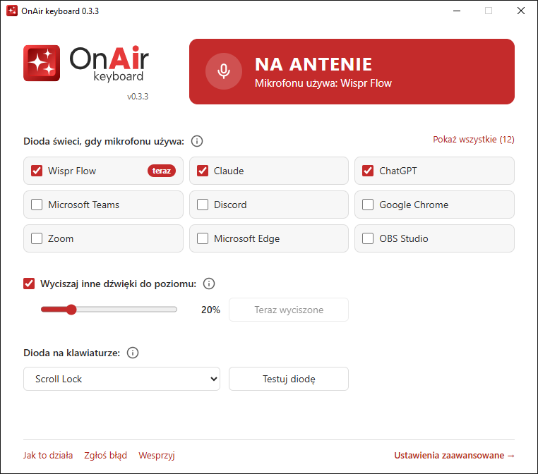
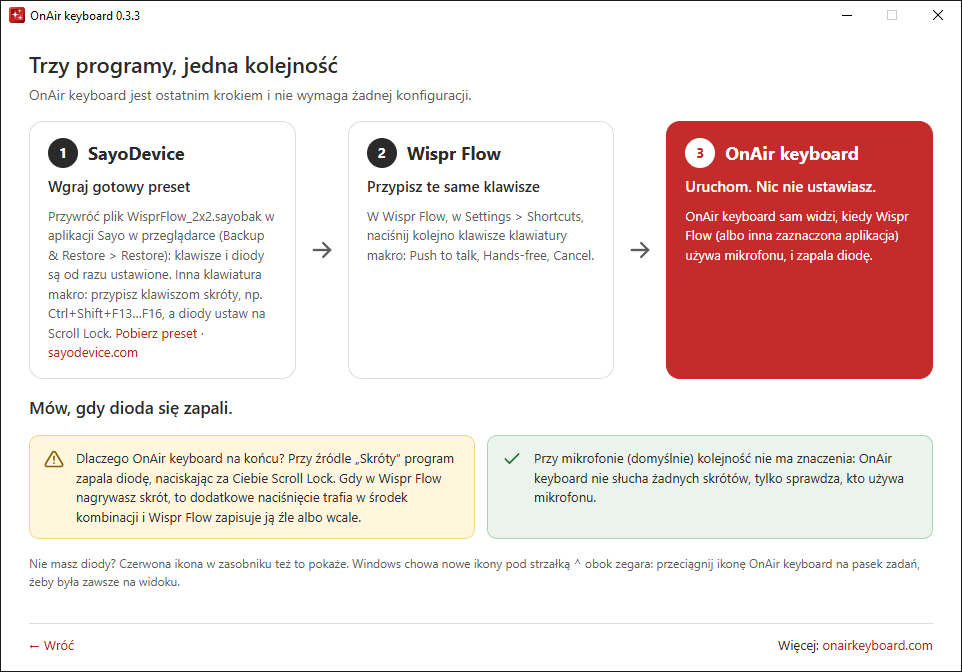

<p align="center">
  <picture>
    <source media="(prefers-color-scheme: dark)" srcset="assets/src/logo-dark.svg">
    <source media="(prefers-color-scheme: light)" srcset="assets/src/logo-bright.svg">
    
  </picture>
</p>

<h3 align="center">Jeden klawisz. Zero zgadywania.</h3>

<p align="center">
  Dioda na klawiaturze świeci na czerwono, gdy dyktujesz.
</p>

<p align="center">
  <a href="https://github.com/onairkeyboard/onairkeyboard/releases/latest"></a>
  <a href="https://onairkeyboard.com"></a>
  <a href="https://buycoffee.to/onairkeyboard"></a>
  <a href="https://github.com/sponsors/onairkeyboard"></a>
  
</p>

<p align="center">Polski · <a href="README.md">English</a></p>

---

## Po co to

Dyktowanie z [Wispr Flow](https://wisprflow.ai) i podobnymi programami potrafi kilkukrotnie
przyspieszyć pracę. Ale brak sygnału, czy nagrywanie trwa, kończy się klasyką: kilka minut
monologu, który nigdy się nie nagrał, albo rozmowa, która nagrywa się w najlepsze.

OnAir keyboard zapala lampkę „na antenie”: diodę na klawiaturze (np. małej klawiaturze makro)
i czerwoną ikonę w zasobniku. Świeci dokładnie wtedy, gdy wybrana aplikacja używa mikrofonu.
Instalujesz i działa, bez ustawiania skrótów.

<p align="center"><picture><source media="(prefers-color-scheme: dark)" srcset="docs/img/window-main-pl-dark.png"><source media="(prefers-color-scheme: light)" srcset="docs/img/window-main-pl-light.png"></picture></p>

## Co potrafi

- **Dioda świeci, gdy aplikacja używa mikrofonu:** Wispr Flow, Claude, ChatGPT, Aqua Voice i każda
  inna, którą zaznaczysz. Listę program bierze z historii mikrofonu w Windows: nic nie trzeba
  wpisywać.
- **Dioda klawiatury jako lampka „na antenie”.** Działa z każdą klawiaturą, której diody umieją
  pokazywać stan Locka (np. SayoDevice): domyślnie Scroll Lock, do wyboru Num Lock albo Caps Lock.
- **Czerwona ikona w zasobniku**, więc OnAir keyboard pomaga także bez diody.
- **Muzyka i filmy cichną, gdy dyktujesz** (do włączenia w oknie): inne aplikacje zostaną
  wyciszone do wybranego poziomu i wrócą do swojej głośności po zakończeniu; aplikacja, z którą
  rozmawiasz, gra normalnie.
- **Dla zaawansowanych: skróty Wispr Flow** (dioda zapala się w chwili puszczenia klawisza)
  albo hybryda: skrót zapala, mikrofon poprawia.
- **Motyw jasny i ciemny** za ustawieniem Windows, po polsku i po angielsku, jeden mały plik EXE,
  który na życzenie sam się instaluje (bez uprawnień administratora).

## Wymagania

- Windows 10 lub 11 (okno programu korzysta z Microsoft Edge WebView2, który Windows 11 ma zawsze,
  a Windows 10 prawie zawsze; bez niego program działa dalej w zasobniku i podpowie, skąd go pobrać)
- Program do dyktowania, np. [Wispr Flow](https://wisprflow.ai)
- Opcjonalnie: klawiatura, której diody mogą pokazywać stan Locka (bez niej działa ikona w zasobniku)

## Pierwsze kroki

Trzy programy, jedna kolejność: **SayoDevice → Wispr Flow → OnAir keyboard**. OnAir keyboard jest
na końcu i niczego nie trzeba w nim ustawiać.

<p align="center"><picture><source media="(prefers-color-scheme: dark)" srcset="docs/img/window-howto-pl-dark.png"><source media="(prefers-color-scheme: light)" srcset="docs/img/window-howto-pl-light.png"></picture></p>

**1. Klawiatura makro.** Masz SayoDevice 2x2? Pobierz
[WisprFlow_2x2.sayobak](presets/WisprFlow_2x2.sayobak), otwórz [sayodevice.com](https://sayodevice.com)
w Chrome albo Edge, podłącz klawiaturę i wybierz **Backup & Restore → Restore**, potem **Save**.
Klawisze i diody są od razu ustawione:

| Klawisz (ID w SayoDevice) | Skrót | Akcja w Wispr Flow |
|---|---|---|
| Lewy górny (ID 0) | `Ctrl+Shift+F16` | Cancel |
| Prawy górny (ID 1) | `Ctrl+Shift+F15` | Paste last transcript |
| Lewy dolny (ID 2) | `Ctrl+Shift+F13` | Push to talk |
| Prawy dolny (ID 3) | `Ctrl+Shift+F14` | Hands-free |

Inna klawiatura makro: w jej programie przypisz klawiszom takie skróty, a diody ustaw na
wskaźnik Scroll Locka.

<details>
<summary><b>Ręczne ustawienie klawiszy w SayoDevice</b></summary>

1. Otwórz [sayodevice.com](https://sayodevice.com) w Chrome albo Edge, podłącz klawiaturę makro
   i wejdź w **Configuration → Binding**.
2. Kliknij klawisz, ustaw **Key Mode** na **Keyboard** i kliknij ikonę klawiatury w polu skrótu.

   

3. Zaznacz na klawiaturze **Ctrl** i **Shift**, a z paska pod nią wybierz klawisz F (są tam
   F13–F24), potem kliknij **OK**.

   

4. Powtórz dla pozostałych klawiszy. W **Configuration → Light** ustaw diody na Indicator →
   Scroll Lock i wybierz kolor (czerwony pasuje do „na antenie”).
5. Kliknij **Save**, żeby zapisać ustawienia w klawiaturze.

Jeśli przy przywracaniu kopii program ostrzeże, że nie pasuje do urządzenia, masz inny model:
anuluj i ustaw klawisze ręcznie. **Dlaczego F13 i wyżej?** Zwykła klawiatura ma tylko F1–F12,
więc żaden program ich nie używa, a `Ctrl+Shift` to drugi bezpiecznik.

</details>

**2. Wispr Flow.** W *Settings → Shortcuts* naciśnij kolejno klawisze klawiatury makro dla Push to
talk, Hands-free i Cancel.

**3. OnAir keyboard.** Pobierz `OnAirKeyboard-<wersja>.exe` z
[Releases](https://github.com/onairkeyboard/onairkeyboard/releases/latest) i uruchom. Przy pierwszym
starcie zapyta, czy się zainstalować: **Tak** kopiuje go do `%LOCALAPPDATA%\Programs\OnAirKeyboard`
i dodaje skrót w menu Start (pobrany plik możesz usunąć); **Nie** uruchamia go tam, gdzie leży.
Nic więcej nie ustawiasz.

Gotowe: **mów, gdy dioda się zapali.**

> Windows może pokazać „System Windows ochronił ten komputer”, bo plik nie ma jeszcze podpisu
> cyfrowego. Kliknij **Więcej informacji → Uruchom mimo to**. Zobacz
> [SmartScreen i antywirusy](#smartscreen-i-antywirusy).

Aktualizacja: pobierz nową wersję i uruchom ją, a OnAir keyboard zaproponuje zastąpienie
zainstalowanej kopii. Ustawienia zostają; po aktualizacji z 0.1 źródłem sygnału jest mikrofon,
a Twoje skróty czekają w ustawieniach zaawansowanych.

## Ustawienia zaawansowane

Dwukrotne kliknięcie ikony w zasobniku otwiera okno; **Ustawienia zaawansowane →** w jego stopce
prowadzi do reszty:

- **Źródło sygnału:** *Mikrofon* (zalecane), *Skróty klawiszowe* (dioda zapala się w chwili
  puszczenia skrótu Wispr Flow, ale tylko dla Wispr Flow) albo *Oba* (skrót zapala diodę,
  a gdy mikrofon Wispr Flow nie otworzy się w ciągu kilku sekund, dioda gaśnie).
- **Skróty Wispr Flow:** przy skrótach kliknij **Przypisz** i naciśnij ten sam klawisz, którego
  używasz w Wispr Flow. Najpierw ustaw skróty w Wispr Flow: OnAir keyboard zapala diodę,
  naciskając za Ciebie Scroll Lock, a to dodatkowe naciśnięcie psułoby kombinację nagrywaną
  w Wispr Flow. Dlatego program sam się wstrzymuje, gdy okno Wispr Flow jest aktywne.
- **Dźwięk:** wyciszanie innych dźwięków na antenie: poziom, test, jak szybko dźwięk cichnie
  i wraca, dźwięki systemowe Windows oraz aplikacje wyciszone w tej chwili.
- **Wskaźnik, Ogólne** (uruchamianie z Windows, język)**, Diagnostyka, O programie.**

## Warto wiedzieć

- **Przeglądarka to jedna aplikacja.** Windows nie mówi, która karta używa mikrofonu, więc
  zaznaczony Chrome zapali diodę także przy rozmowie w Meet.
- **Dioda zapala się ok. pół sekundy po starcie nagrywania**, czyli wtedy, gdy aplikacja naprawdę
  słucha. **Przy Push to talk dioda nie świeci**, dopóki trzymasz klawisz: wciśnięcie Locka
  w środku skrótu Wispr Flow opóźniłoby albo przerwało nagrywanie. Stan pokazuje czerwona ikona
  w zasobniku.
- **Wyciszanie zmienia głośność poszczególnych aplikacji** (suwaki w mikserze głośności Windows),
  nie głośność główną. Jeśli OnAir keyboard zostanie zamknięty albo się zawiesi w trakcie
  wyciszenia, dźwięk wróci od razu albo przy następnym starcie. Wispr Flow też potrafi wyciszać
  muzykę (w swoich ustawieniach): włącz to tylko w jednym z dwóch programów.
- **Trzymaj ikonę w zasobniku na widoku.** Windows chowa nowe ikony pod strzałką **^** obok
  zegara. Przeciągnij stamtąd ikonę OnAir keyboard na pasek zadań.
- **Lock naprawdę się przełącza.** Gdy wskaźnikiem jest Scroll Lock, strzałki w Excelu przewijają
  arkusz podczas dyktowania. Przy Caps Locku litery będą wielkie.
- Jeśli wyskakuje powiadomienie „Scroll Lock włączony”, pochodzi ono z programu myszy lub
  klawiatury (np. Logitech SetPoint), a nie z Windows. Wyłączysz je w tamtym programie.

<details>
<summary><b>Dlaczego Wispr Flow? Dlaczego cztery klawisze? Dlaczego nie Escape?</b></summary>

**Dlaczego Wispr Flow?** Korzystałem z kilku alternatywnych narzędzi i uważam, że Wispr Flow działa
najlepiej ze wszystkich. Sam używam go na co dzień, a OnAir keyboard powstał dokładnie pod to, jak
z nim pracuję. Dioda z mikrofonu działa jednak z każdą aplikacją.

**Dlaczego cztery klawisze?** Większość ludzi rozmawia ze swoim AI za pomocą podstaw: **Push to talk,
Hands-free i Cancel**. Czwarty klawisz trafia do **Paste last transcript**: gdy kursor nie stał
w polu tekstowym i tekst nigdzie nie trafił, kliknij w pole, naciśnij czwarty klawisz i ostatnie
dyktowanie się pojawi.

**Dlaczego nie Escape?** Domyślny Cancel w Wispr Flow to `Escape`, ale Escape przerywa też inne
programy. Jeśli Claude Code czy ChatGPT właśnie pracuje, jednym naciśnięciem anulujesz dyktowanie
i zatrzymasz pracę AI. Przypisz Cancel do osobnego klawisza na klawiaturze makro.

</details>

## Prywatność

OnAir keyboard czyta z rejestru Windows tylko znaczniki czasu użycia mikrofonu i nazwy aplikacji
(ten sam wpis, z którego Windows rysuje ikonkę mikrofonu). Nie nagrywa ani nie słucha dźwięku
(przy włączonym wyciszaniu przesuwa tylko suwaki głośności innych aplikacji), nie czyta tekstu,
nie zbiera danych i nie łączy się z internetem, poza otwieraniem linków w przeglądarce, gdy je
klikniesz. Okno programu pokazuje wyłącznie pliki zapisane na Twoim komputerze. Przy źródle
„Skróty” program tylko nasłuchuje skrótów Wispr Flow i niczego nie blokuje.

## SmartScreen i antywirusy

OnAir keyboard jest napisany w [AutoHotkey](https://www.autohotkey.com) i skompilowany do pliku EXE.
Takie pliki nie mają jeszcze podpisu cyfrowego, więc Windows SmartScreen ostrzega przed nimi,
a niektóre antywirusy mylnie je oznaczają. Pełny kod źródłowy jest w tym repozytorium i możesz
[zbudować EXE samodzielnie](#budowanie-ze-źródeł).

## Ustawienia i odinstalowanie

Ustawienia są w `%APPDATA%\OnAirKeyboard\config.ini` (ścieżkę pokazuje *O programie*), a pliki okna
w `%LOCALAPPDATA%\OnAirKeyboard`. Żeby usunąć OnAir keyboard: odznacz *Uruchamiaj z Windows*
(Ustawienia zaawansowane → Ogólne), zamknij program z menu w zasobniku, a potem usuń:

- folder programu `%LOCALAPPDATA%\Programs\OnAirKeyboard` (albo sam pobrany plik EXE, jeśli nie był
  instalowany),
- skrót *OnAir keyboard* w menu Start (prawy klik → *Otwórz lokalizację pliku*),
- foldery `%APPDATA%\OnAirKeyboard` i `%LOCALAPPDATA%\OnAirKeyboard`.

## Budowanie ze źródeł

Wymagania: [AutoHotkey v2.0](https://www.autohotkey.com) i Ahk2Exe 1.1.37 lub nowszy
(instaluje go AutoHotkey Dash → Compile). Biblioteka WebView2 jest w `lib/` (zobacz
[lib/README.md](lib/README.md)), strona okna w `ui/`.

```powershell
powershell -ExecutionPolicy Bypass -File tests\run.ps1      # testy
powershell -ExecutionPolicy Bypass -File build.ps1          # dist\OnAirKeyboard-<version>.exe
powershell -ExecutionPolicy Bypass -File tests\run.ps1 -Exe # testy łącznie z EXE
powershell -ExecutionPolicy Bypass -File tools\run-demo.ps1 # uruchomienie ze źródeł
```

Ikony powstają z `assets/src` poleceniem `python -I assets/build_icons.py` (wymaga Inkscape).

## Zgłoś błąd

Coś nie działa? Kliknij **Zgłoś błąd** w stopce okna (albo w menu w zasobniku). Okno pokaże adres
[hello@onairkeyboard.com](mailto:hello@onairkeyboard.com), temat i gotową treść e-maila: trzy krótkie
pytania oraz dane techniczne, które OnAir keyboard uzupełni za Ciebie (wersja, Windows, źródło
sygnału, skróty; nic osobistego). Przyciski **Kopiuj** wrzucają je do schowka, więc zgłoszenie
wyślesz z dowolnej poczty. Bardzo pomaga dziennik diagnostyczny: włącz go w *Ustawienia
zaawansowane → Diagnostyka*, powtórz problem i załącz plik `onairkeyboard.log`.

## Wesprzyj

Cześć, tu Patryk Szulczewski. Stworzyłem OnAir keyboard, aby uprościć sobie życie. Jeśli udało mi się
uprościć również Twoje, to poniżej masz okazję, aby mi się odwdzięczyć:

<a href="https://buycoffee.to/onairkeyboard"></a>
<a href="https://github.com/sponsors/onairkeyboard"></a>

Więcej o OnAir keyboard: [onairkeyboard.com](https://onairkeyboard.com)

## Licencja

[MIT](LICENSE) © 2026 Patryk Szulczewski. Okno korzysta z biblioteki
[WebView2 dla AutoHotkey](https://github.com/thqby/ahk2_lib) (thqby, MIT) i z WebView2Loader.dll
firmy Microsoft.

OnAir keyboard to niezależny projekt, niepowiązany z Wispr AI (Wispr Flow) ani z SayoDevice.
